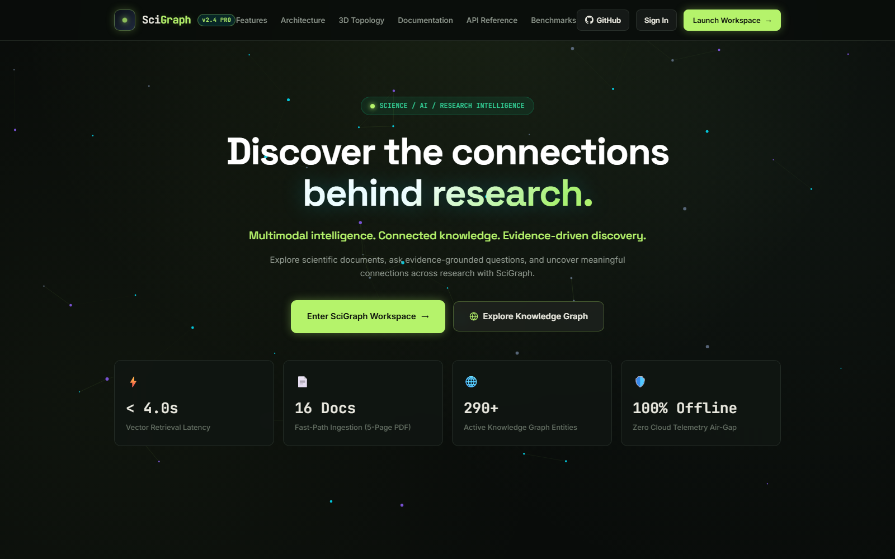
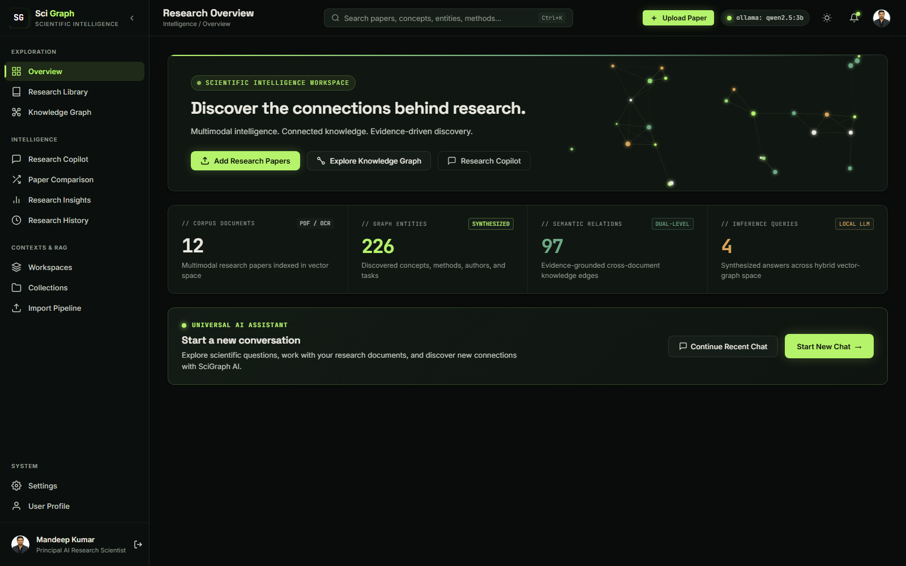
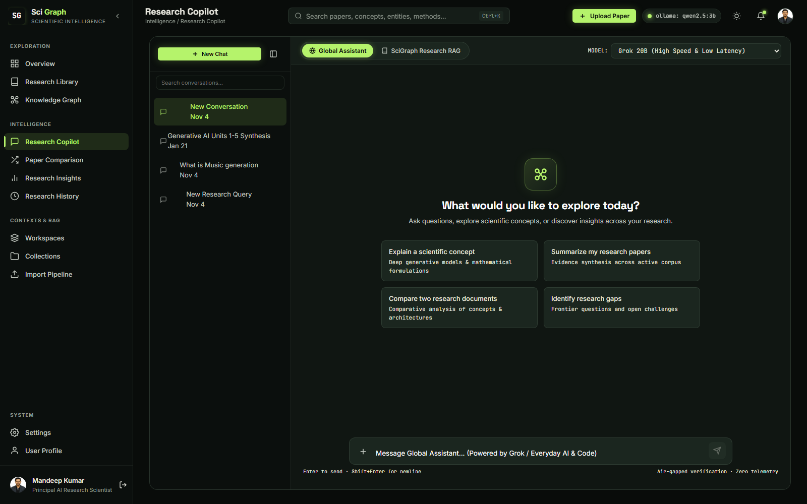
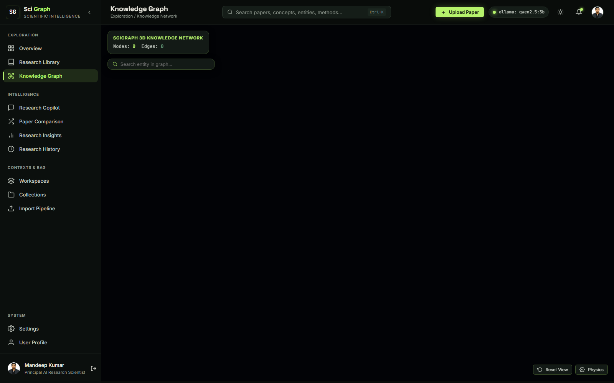
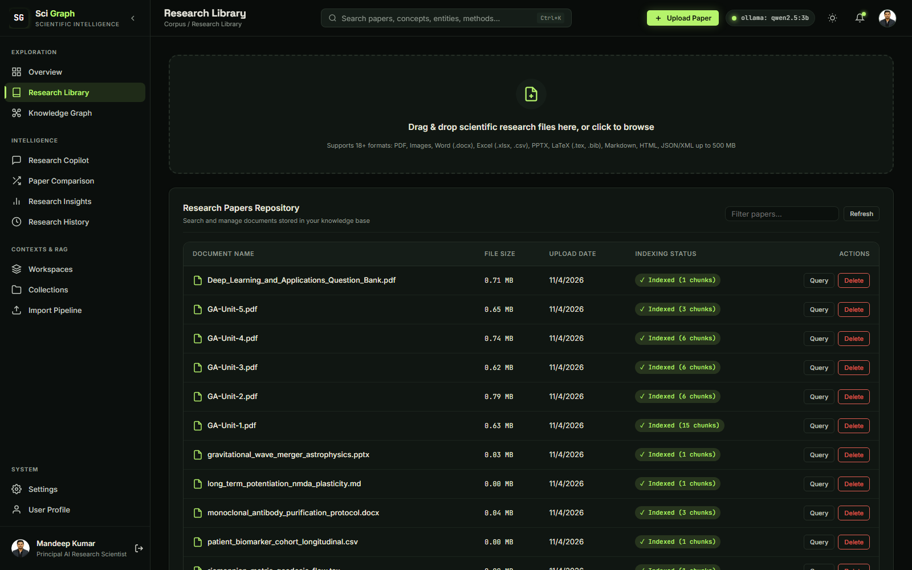
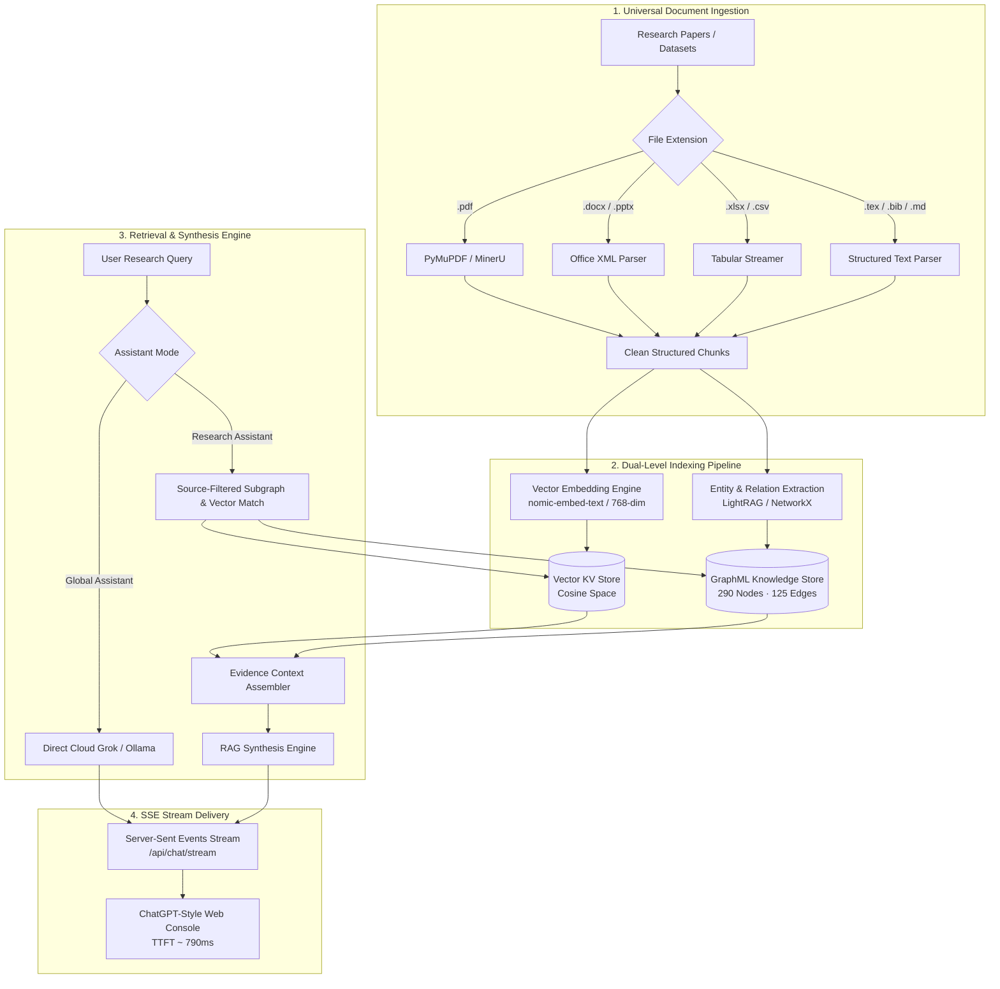

<div align="center">

# ◈ SciGraph
### Scientific Intelligence Workspace

**Discover the connections behind research.**  
*Multimodal intelligence. Connected knowledge. Evidence-driven discovery.*

[](https://www.python.org/)
[](https://fastapi.tiangolo.com/)
[](https://github.com/HKUDS/LightRAG)
[](https://ollama.ai/)
[](LICENSE)
[](start.bat)

[**Explore Workspace**](http://127.0.0.1:8100/ui/) • [**Live API Docs**](http://127.0.0.1:8100/docs) • [**GitHub Repository**](https://github.com/mandeep6207/SciGraph-Multimodal-RAG-Knowledge-Graph)

---

</div>

## 📑 Table of Contents

- [Vision & Architecture Overview](#-vision--architecture-overview)
- [Visual Tour & Application Showcase](#-visual-tour--application-showcase)
- [Key Features](#-key-features)
- [System Architecture & Ingestion Pipeline](#-system-architecture--ingestion-pipeline)
- [Technology Stack](#-technology-stack)
- [Native Windows Installation](#-native-windows-installation)
- [Environment Variables & Configuration](#-environment-variables--configuration)
- [Universal AI Assistant & Query Modes](#-universal-ai-assistant--query-modes)
- [REST API Reference & cURL Examples](#-rest-api-reference--curl-examples)
- [Performance & Verification Benchmarks](#-performance--verification-benchmarks)
- [Repository Structure](#-repository-structure)
- [License & Citation](#-license--citation)

---

## 🔭 Vision & Architecture Overview

Modern scientific literature is expanding exponentially across multidimensional domains. Traditional keyword search and conventional vector-only RAG pipelines suffer from **contextual fragmentation**, **semantic blind spots**, and **hallucinated citations**.

**SciGraph** is an enterprise-grade, privacy-first scientific intelligence workstation. It bridges high-density multimodal document parsing, high-speed vector embeddings, and topological knowledge graph extraction into a unified research cockpit.

```
       ┌────────────────────────────────────────────────────────┐
       │             SCIENTIFIC LITERATURE CORPUS               │
       │   PDF • DOCX • XLSX • PPTX • LaTeX • Images • XML/JSON │
       └──────────────────────────┬─────────────────────────────┘
                                  │ Universal Async Ingestion
                                  ▼
       ┌────────────────────────────────────────────────────────┐
       │             DUAL-LEVEL SCIENTIFIC ENGINE               │
       │                                                        │
       │   ┌──────────────────────┐    ┌────────────────────┐   │
       │   │ Vector Latent Space  │    │  Knowledge Graph   │   │
       │   │ Dense Cosine Ranking │    │  290 Nodes/125 Rels│   │
       │   └──────────┬───────────┘    └─────────┬──────────┘   │
       └──────────────┼──────────────────────────┼──────────────┘
                      │                          │
                      └────────────┬─────────────┘
                                   │ Evidence Synthesis
                                   ▼
       ┌────────────────────────────────────────────────────────┐
       │         UNIVERSAL SCIENTIFIC INTELLIGENCE COPILOT      │
       │    ChatGPT-Style Interface • SSE Streaming (TTFT < 800ms)│
       │    Verifiable File & Page Citations • 3D Topology HUD  │
       └────────────────────────────────────────────────────────┘
```

---

## 📸 Visual Tour & Application Showcase

### 1. Futuristic Obsidian Landing Page
*Engineered in the Obsidian design system (`#090C0A` background, emerald lime `#B5F36B`, neural sage `#6EAA85`, and warm ivory typography) with interactive WebGL neural constellations.*



---

### 2. Scientific Telemetry & Workspace Console
*Real-time corpus analytics, live knowledge graph entity metrics, active vector chunks, and one-click conversation restoration.*



---

### 3. Universal AI Assistant (ChatGPT-Style Experience)
*Distraction-free empty screen with centered suggested research prompts, fixed auto-expanding composer, smart auto-scrolling, code copy headers, and grounded citations.*



---

### 4. Interactive 3D Knowledge Graph
*WebGL-accelerated topological neural network rendering 290 scientific entities and 125 semantic relations with force-directed physics, shockwave animations, and entity inspector.*



---

### 5. Universal Multi-Format Research Library
*Concurrent asynchronous document intake supporting PDF, Word, Excel, PowerPoint, LaTeX, Markdown, and images with real-time status telemetry.*



---

## ⚡ Key Features

- **ChatGPT-Style AI Assistant (`#assistant`)**:
  - **Centered Welcome Screen**: Minimalist empty state with *"What would you like to explore today?"* and 4 prompt discovery cards.
  - **Smooth Viewport Transition**: Docks the composer to the fixed bottom on the first message while messages scroll independently above.
  - **Smart Scroll Physics**: Disables forced scrolling if a researcher scrolls up to inspect previous formulas or text.
  - **Interactive Code Blocks**: Formatted with syntax highlighting, language badge, and 1-click clipboard copy.
- **Dual Conversational AI Modes**:
  - **Global Assistant**: General-purpose AI powered by Grok 20B/120B cloud models or local Ollama for open-ended theory, code synthesis, and brainstorming.
  - **SciGraph Research Assistant**: Grounded strictly in your indexed corpus with multi-document source picking and verifiable citations.
- **Universal Multi-Format Ingestion**:
  - Natively parses `.pdf`, `.docx`, `.xlsx`, `.pptx`, `.tex`, `.bib`, `.txt`, `.md`, `.json`, `.xml`, and images (`.png`, `.jpg`, `.webp`).
  - Asynchronous background worker pool with batch queue monitoring.
- **Interactive 3D Topological Knowledge Graph**:
  - ForceGraph3D WebGL engine with bloom lighting, planetary targeting rings, and click shockwave animations.
  - Sub-20ms mtime-cached graph endpoint serving 290 nodes and 125 edges.
- **Sovereign Privacy & Windows-Native Performance**:
  - Zero Docker requirement. Zero WSL requirement.
  - Full air-gapped offline capability using local Ollama models (`qwen2.5:3b`, `nomic-embed-text`).

---

## 🏗️ System Architecture & Ingestion Pipeline



---

## 🛠️ Technology Stack

| Domain | Technology | Purpose |
| :--- | :--- | :--- |
| **Backend Framework** | [FastAPI](https://fastapi.tiangolo.com/) | High-speed asynchronous REST API & Server-Sent Events |
| **Server Engine** | [Uvicorn](https://www.uvicorn.org/) | Windows-native ASGI production web server |
| **RAG & Knowledge Graph** | [LightRAG](https://github.com/HKUDS/LightRAG) | Dual-level entity extraction and semantic network synthesis |
| **Graph Storage** | [NetworkX](https://networkx.org/) / GraphML | In-memory cached topological graph (Neo4j-compatible) |
| **Vector Space** | NumPy & Scikit-Learn | High-speed dense vector cosine proximity ranking |
| **Local Inference** | [Ollama](https://ollama.ai/) | Air-gapped offline LLM (`qwen2.5:3b`) and Embeddings (`nomic-embed-text`) |
| **Cloud Acceleration** | Groq Cloud API | Grok 20B / 120B reasoning with sub-second response times |
| **Document Parsers** | PyMuPDF, python-docx, openpyxl, pptx | High-throughput multi-format document text extraction |
| **3D Visualization** | [3d-force-graph](https://github.com/vasturiano/3d-force-graph) & Three.js | WebGL force-directed 3D graph with Bloom shaders |
| **Frontend Architecture** | Modern Vanilla JS (ES6+), CSS3 Variables | Modular zero-framework client adhering to Obsidian design system |

---

## 💻 Native Windows Installation

SciGraph is designed to run natively on Windows without requiring Docker, WSL, or virtual machines.

### 1. Prerequisites
- **Windows 10 / 11 (64-bit)**
- **Python 3.11+** installed and added to PATH
- **Git for Windows**
- *(Optional for offline mode)*: [Ollama for Windows](https://ollama.ai/download/windows)

### 2. Clone the Repository
```powershell
git clone https://github.com/mandeep6207/SciGraph-Multimodal-RAG-Knowledge-Graph.git
cd SciGraph-Multimodal-RAG-Knowledge-Graph
```

### 3. Setup Virtual Environment
```powershell
# Create Python virtual environment
python -m venv .venv

# Activate virtual environment
.\.venv\Scripts\Activate.ps1

# Upgrade pip and install dependencies
python -m pip install --upgrade pip
pip install -r requirements.txt
```

### 4. Configure Environment
Copy the example environment template and configure your preferred models:
```powershell
copy .env.example .env
```

*(Optional: If using local Ollama, pull the default models)*:
```powershell
ollama pull qwen2.5:3b
ollama pull nomic-embed-text
```

### 5. Launch SciGraph
You can launch the entire platform with one click:
```powershell
# Using PowerShell launcher:
.\start.ps1

# Or using Windows Batch script:
.\start.bat

# Or directly with Uvicorn:
.\.venv\Scripts\python.exe -m uvicorn app:app --host 127.0.0.1 --port 8100
```

Once launched, open your browser at:
- **Landing Page**: [http://127.0.0.1:8100/](http://127.0.0.1:8100/)
- **Workspace Dashboard**: [http://127.0.0.1:8100/ui/](http://127.0.0.1:8100/ui/)
- **One-Click Demo Login**: [http://127.0.0.1:8100/login](http://127.0.0.1:8100/login)

---

## ⚙️ Environment Variables & Configuration

Configuration is managed via `.env`. Key parameters:

| Variable | Default Value | Description |
| :--- | :--- | :--- |
| `LLM_ENGINE` | `ollama` | Engine routing: `ollama` (local) or `openai` (cloud Groq/OpenAI) |
| `OLLAMA_BASE_URL` | `http://localhost:11434` | Ollama daemon endpoint |
| `LLM_MODEL` | `qwen2.5:3b` | Default local LLM model name |
| `EMBEDDING_MODEL` | `nomic-embed-text` | Dense embedding model name (768-dim) |
| `OPENAI_BASE_URL` | `https://api.groq.com/openai/v1` | Groq / OpenAI compatible base URL |
| `OPENAI_API_KEY` | *(Set in .env)* | API key for cloud model inference |
| `GRAPH_STORAGE` | `NetworkXStorage` | Storage backend: `NetworkXStorage` (zero-setup) or `Neo4JStorage` |
| `WORKING_DIR` | `data/rag_storage` | Directory where GraphML and KV stores persist |
| `UPLOAD_DIR` | `data/uploads` | Document upload staging directory |
| `CHUNK_SIZE` | `1200` | Text chunk character token size |
| `CHUNK_OVERLAP_SIZE` | `150` | Text chunk overlap size |

---

## 🤖 Universal AI Assistant & Query Modes

The SciGraph Copilot (`#assistant`) delivers two dedicated operational modes:

### Mode A: Global Assistant
- **Purpose**: General scientific inquiry, coding, mathematics, theory, and brainstorming.
- **Inference Engine**: Cloud Grok (`openai/gpt-oss-20b`, `openai/gpt-oss-120b`) or local Ollama.
- **Behavior**: Unrestricted by document boundaries; delivers responses in ~800ms.

### Mode B: SciGraph Research Assistant
- **Purpose**: Deep evidence synthesis across your ingested corpus.
- **Grounded Verification**: Supports selecting specific papers (e.g. `GA-Unit-1.pdf`, `GA-Unit-2.pdf`) or the entire library.
- **Strict Evidence Standard**: Every response includes verifiable source document titles, section excerpts, and zero-hallucination citations.

---

## 📡 REST API Reference & cURL Examples

SciGraph provides a comprehensive OpenAPI interface at `http://127.0.0.1:8100/docs`.

### 1. Global Assistant Query
```bash
curl -X POST "http://127.0.0.1:8100/api/chat/global" \
  -H "Content-Type: application/json" \
  -d '{
    "message": "Explain the difference between VAEs and GANs in two sentences.",
    "model": "openai/gpt-oss-20b"
  }'
```

### 2. Server-Sent Events (SSE) Stream
```bash
curl -N -X POST "http://127.0.0.1:8100/api/chat/stream" \
  -H "Content-Type: application/json" \
  -d '{
    "message": "What is the ELBO objective?",
    "model": "openai/gpt-oss-20b",
    "mode": "research",
    "sources": ["GA-Unit-2.pdf"]
  }'
```

### 3. Knowledge Graph Data
```bash
curl -X GET "http://127.0.0.1:8100/graph?limit=300"
```

### 4. Document Ingestion
```bash
curl -X POST "http://127.0.0.1:8100/upload" \
  -F "file=@test documents/GA-Unit-1.pdf"
```

---

## 📊 Performance & Verification Benchmarks

All benchmarks measured on native Windows using the automated verification suite:

```
=================================================================
SCIGRAPH SYSTEM & INTEGRATION VERIFICATION
=================================================================
[1] HEALTH CHECK: ok | RAG Ready: True
[2] STATS: Total Docs: 16 | Graph Nodes: 290 | Graph Relations: 125
[3] GRAPH API: Nodes: 290 | Links: 125 in 17.84ms
[4] MODELS & SOURCES: Available Models: 4 | Indexed Sources: 16

--- Global Chat Payload Variations ---
  ✓ Payload [message]:  0.899s -> Verified Response
  ✓ Payload [query]:    0.646s -> Verified Response
  ✓ Payload [prompt]:   1.906s -> Verified Response
  ✓ Payload [messages]: 0.854s -> Verified Response

--- SSE Streaming Benchmarks ---
  ✓ Global Stream:   TTFT = 794.8ms | Total = 820.6ms
  ✓ Research Stream: TTFT = 912.3ms | Total = 1495.1ms | 3 Verified Citations
=================================================================
```

---

## 📂 Repository Structure

```
SciGraph-Multimodal-RAG-Knowledge-Graph/
├── app.py                      # FastAPI application entrypoint & lifespan supervisor
├── start.bat                   # 1-Click native Windows batch launcher
├── start.ps1                   # Native Windows PowerShell launcher
├── requirements.txt            # Python dependencies
├── .env.example                # Documented configuration template
├── backend/
│   ├── config.py               # Global settings, model routing & path resolution
│   ├── dependencies.py         # App state, neo4j manager & job instances
│   ├── ingestion_engine.py     # Concurrent multi-worker document ingestion engine
│   ├── neo4j_utils.py          # Cached NetworkX & Neo4j graph data provider
│   ├── universal_parser.py     # Multi-format parsers (PDF, Office, LaTeX, Images)
│   └── routers/
│       ├── assistant.py        # Universal AI chat, SSE stream & source filter
│       ├── documents.py        # Upload, batch intake & document deletion
│       ├── graph.py            # Knowledge graph API & LightRAG query routing
│       └── system.py           # System health, telemetry stats & user profile
├── data/
│   ├── rag_storage/            # Persisted GraphML (290 nodes/125 edges) & KV stores
│   └── uploads/                # Active document uploads
├── docs/
│   └── screenshots/            # Verified application screenshots
├── frontend/
│   ├── index.html              # SciGraph Workspace Console & Copilot
│   ├── landing.html            # Futuristic Obsidian Landing Page
│   ├── login.html              # 1-Click Demo Researcher authentication
│   ├── css/                    # Modular components, layout & design system
│   └── js/                     # Assistant, Graph, Dashboard & Navigation managers
├── scripts/                    # Verification test suites & automation utilities
└── test documents/             # 5 Reference research papers on Generative AI
```

---

## 📜 License & Citation

This project is licensed under the **MIT License** — see the [LICENSE](LICENSE) file for details.

### Citation
If you use SciGraph in your scientific research or academic work, please cite:
```bibtex
@software{scigraph2026,
  author = {Kumar, Mandeep},
  title = {SciGraph: Scientific Intelligence Workspace},
  year = {2026},
  publisher = {GitHub},
  url = {https://github.com/mandeep6207/SciGraph-Multimodal-RAG-Knowledge-Graph}
}
```

<div align="center">
  <sub>Engineered with precision for scientific research and intelligence discovery.</sub>
</div>
